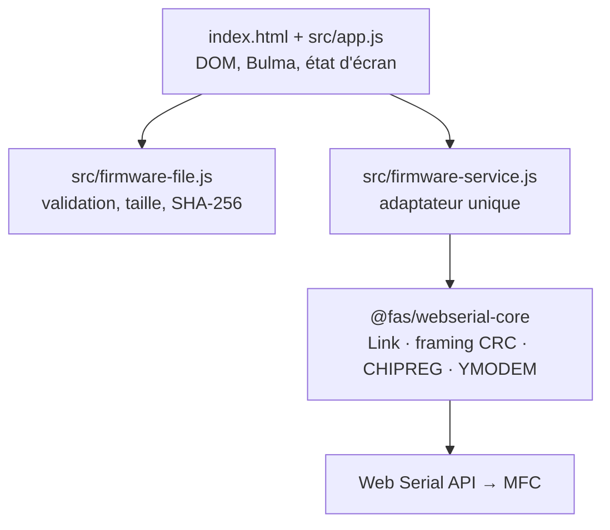

# Architecture — fluid-control-pwa

## 1. Objectif et contraintes

PWA **single page**, hébergée telle quelle sur **GitHub Pages**, permettant de tester et de
mettre à jour des régulateurs de débit (MFC) connectés en série via la **Web Serial API**.

| Contrainte | Conséquence d'architecture |
|---|---|
| GitHub Pages = hébergement statique | aucun backend, aucune variable d'environnement, aucun secret |
| Pas d'étape de build | JavaScript natif en **modules ES**, Bulma en CDN, aucun bundler |
| Sous-chemin `/fluid-control-pwa/` | **tous les chemins sont relatifs** (`./…`), jamais absolus (`/…`) |
| Web Serial API | contexte **HTTPS** obligatoire, Chrome/Edge desktop uniquement, `requestPort()` déclenché par un geste utilisateur |
| PWA | `manifest.webmanifest` + service worker avec cache versionné |

> **Non supporté :** Firefox, Safari, iOS/iPadOS n'implémentent pas la Web Serial API.
> L'application se charge quand même et affiche une bannière d'avertissement.

## 2. Structure du dépôt

```text
fluid-control-pwa/
├── index.html                      page unique (shell Bulma)
├── manifest.webmanifest            métadonnées PWA
├── sw.js                           service worker (precache app shell)
├── .nojekyll                       désactive Jekyll sur GitHub Pages
├── assets/
│   ├── css/app.css                 overrides Bulma minimes
│   └── icons/                      icônes PWA (SVG)
├── src/
│   ├── app.js                      composition : DOM ↔ domaine
│   ├── firmware-file.js            domaine : lecture/validation du fichier
│   ├── firmware-service.js         adaptateur @fas/webserial-core (seul point d'intégration)
│   └── vendor/webserial-core/      distribution ESM de la librairie (générée, commitée)
├── scripts/vendor-core.ps1         installation/mise à jour de la librairie
└── docs/ARCHITECTURE.md            ce document
```

## 3. Découpage en couches



Règles :

1. **`app.js` ne connaît pas la librairie.** Il n'importe que `firmware-service.js`.
2. **`firmware-file.js` ne touche pas au DOM** ni au port série : testable et réutilisable
   (glisser-déposer, File System Access API…).
3. **`firmware-service.js` est le seul endroit qui importe `src/vendor/webserial-core/`.**
   Changer de version, de chemin ou de mode de livraison n'impacte que ce fichier.
4. L'import de la librairie est **dynamique** (`import()`), donc :
   - elle n'est téléchargée que lorsqu'on en a besoin ;
   - son absence ne casse pas la page, l'UI se dégrade en mode « lecture de fichier seule ».

## 4. Intégration de `@fas/webserial-core`

### 4.1 Ce que fournit la librairie

Branche `feat/typescript-core` du dépôt `PE-FAS-IND/webserial_instrument-core`. Le dossier
`dist/` est **commité** dans la branche : il contient des modules ES `es2022` prêts à
l'emploi (imports relatifs entre chunks, pas de spécificateur « bare » à résoudre).

Points d'entrée utiles :

| Fichier | Contenu |
|---|---|
| `dist/index.js` | noyau : `Link`, `WebSerialTransport`, framings, codecs |
| `dist/devices/chipreg.js` | driver MFC : `createChipreg`, `sendChipregFirmware` |
| `dist/devices.js` | barrel « tous drivers » — **seul endroit exposant `runFirmwareUpdateSequence`** |
| `dist/global/chipreg.global.js` | bundle IIFE autonome exposant `window.ChipregMFC` (compat pages legacy) |

C'est pour `runFirmwareUpdateSequence` que l'adaptateur importe `devices.js` plutôt que
`devices/chipreg.js`.

### 4.2 Option retenue : vendoring de `dist/`

Trois options possibles :

| Option | Avantages | Inconvénients |
|---|---|---|
| **A. Vendoring de `dist/` (retenue)** | zéro build, zéro dépendance réseau, déployable tel quel | mise à jour manuelle via script |
| B. Submodule git | historique de version propre | GitHub Pages ne publie pas les submodules sans workflow Actions |
| C. npm + bundler | ergonomie de dev, types TS | introduit une chaîne de build, contraire à l'objectif |

### 4.3 Procédure

```powershell
# depuis la racine du dépôt
pwsh ./scripts/vendor-core.ps1
```

Le script clone la branche, copie `dist/*` dans `src/vendor/webserial-core/`, supprime les
`.map` (ils pointent vers des sources absentes du déploiement) et préserve le `README.md`
du dossier. Pour travailler depuis un clone local :

```powershell
pwsh ./scripts/vendor-core.ps1 -Source C:\data\github_repo\webserial_instrument-core
```

Après copie, **committez `src/vendor/webserial-core/`** et incrémentez `CACHE_VERSION` dans
[sw.js](../sw.js).

### 4.4 La distribution est commitée — et pourquoi

GitHub Pages publie **uniquement le contenu du dépôt**. Un `src/vendor/` ignoré n'est jamais
déployé : l'import dynamique échoue en production et l'application affiche « librairie non
installée » alors qu'elle fonctionne en local. Ces 48 fichiers sont donc versionnés.

Conséquence à assumer : `@fas/webserial-core` est privée et déclarée `UNLICENSED`. Si
`fluid-control-pwa` est public, son code devient lisible par tous — dans le dépôt comme sur
le site. **Un site Pages est public dès que le dépôt l'est** ; seul GitHub Enterprise permet
un Pages privé.

Si cette exposition devient un problème, la seule alternative est d'injecter la librairie au
déploiement via un workflow Actions (clone avec token, `vendor-core.ps1`, publication de
l'artefact). Le code sort alors du dépôt mais reste téléchargeable depuis le site : cela
protège l'historique Git, pas le code lui-même.

Règle de travail : `src/vendor/` est **généré**. Ne jamais l'éditer à la main, toute
modification est écrasée par `vendor-core.ps1`.

#### Licence

Le dépôt est sous licence **propriétaire, tous droits réservés** ([LICENSE](../LICENSE)),
qui exclut explicitement `src/vendor/` — ce dossier reste régi par les conditions de son
dépôt d'origine, récapitulées dans [NOTICE](../NOTICE). Sans cette exclusion, un `LICENSE`
à la racine relicencierait involontairement la librairie.

### 4.5 Séquence de mise à jour firmware

Implémentée dans [src/firmware-service.js](../src/firmware-service.js) :

```js
const mfc = createChipreg({ address: "ff" });   // "ff" = broadcast
await mfc.connect({ baudRate: 115200 });        // requestPort() + open() — geste utilisateur requis

// 1. Déverrouillage : GOBW puis challenges FWDW/FWCW (bootloader, patcher, application)
const sequence = await runFirmwareUpdateSequence(mfc, { onStep });

// 2. Resynchronisation obligatoire après le redémarrage du MCU
await mfc.reconnect();

// 3. Transfert YMODEM (blocs 1024 o, CRC16 Modbus — pas le CCITT standard)
await sendChipregFirmware(mfc, bytes, { fileName, onProgress });

await mfc.disconnect();
```

> **Le `reconnect()` de l'étape 2 n'est pas optionnel.** Après `requestApplicationUpdate`, le
> MCU a redémarré en bootloader : le port doit être fermé puis rouvert pour se
> resynchroniser avant le premier bloc. L'implémentation de référence validée sur matériel
> (`fas-digital-manufacturing`, méthode `enterBinaryMode()`) fait exactement cela.
>
> Les tests unitaires de la librairie ne couvrent **pas** ce point : ils s'exécutent sur un
> transport simulé, où une resynchronisation n'a aucun sens. Ne pas en déduire que le
> `reconnect()` est superflu.

Détails qui comptent côté UI :

- `runFirmwareUpdateSequence` renvoie `{ success, steps[], failedStep, error }` au lieu de
  lever : l'opérateur doit voir **où** la séquence s'est arrêtée (`jumpToBootloader`,
  `requestBootloaderUpdate`, `confirmBootloaderChallenge`, `requestPatcherUpdate`,
  `confirmPatcherChallenge`, `requestApplicationUpdate`).
- `onProgress` fournit `{ sentBytes, totalBytes, block, percent }` → `progress` Bulma.
- `sendChipregFirmware` renvoie `{ bytesSent, blocks, fileName, validated }` ; `validated`
  à `false` signifie que le bootloader n'a pas renvoyé l'ACK final après le contrôle CRC32.
- Le port série est **exclusif** : une seule connexion à la fois, `disconnect()` systématique
  dans un `finally`.
- `skipJump: true` sert quand l'appareil est déjà en bootloader (reprise après échec).

#### Paramètres YMODEM

Les valeurs par défaut de la librairie sont identiques à celles de la référence : blocs de
1024 o (STX), `bootDelay` 1500 ms, `postHeaderDelay` 2000 ms, `firstBlockTimeout` 8000 ms,
`blockTimeout` 1000 ms, `interBlockDelay` 20 ms, `maxRetries` 10, `validationTimeout`
20 000 ms, padding `0x1A`, CRC16 Modbus. **Ne pas les modifier sans mesure sur matériel.**

Le bootloader est *PC-initiated* : il n'émet pas de `C` de sollicitation après le reset,
l'hôte envoie directement le bloc d'en-tête. Le baudrate ne change pas entre application et
bootloader.

### 4.6 Détection automatique de la vitesse

L'opérateur n'a pas à connaître le baudrate configuré dans le MFC. `connectDevice()` ouvre le
port une seule fois (`requestPort()`, geste utilisateur) puis balaie les vitesses avec
`reopen({ baudRate })`, en interrogeant `IDER` à chaque essai :

```
115200 → 57600 → 38400 → 19200 → 9600
```

- La vitesse sélectionnée dans l'UI est **essayée en premier** : le cas courant coûte un
  seul essai, la liste sert de repli.
- Le critère de réussite est une trame `IDER` complète et **à checksum valide** : du bruit
  généré par une mauvaise vitesse ne peut pas être pris pour une réponse.
- `timeout` par essai : 1000 ms. Pire cas mesuré pour un appareil muet : ~8 s.
- Si aucune vitesse ne répond, la session reste ouverte sur la vitesse préférée et
  `identification` vaut `null` : un MFC déjà en bootloader ne répond à `IDER` sur aucune
  vitesse mais accepte quand même un transfert.
- À la réussite, la liste déroulante est mise à jour avec la vitesse détectée.

### 4.7 Écarts assumés avec l'implémentation de référence

| Point | Référence (`fas-digital-manufacturing`) | Ici |
|---|---|---|
| Sélection du port | `requestPort()` sans filtre | identique |
| `getPorts()` (port déjà autorisé) | non utilisé | non utilisé |
| Bouton « Connecter » séparé | oui, avec adresse + baudrate | identique |
| Choix du baudrate | manuel, obligatoire | balayage automatique (§4.6) |
| Événements `serial.connect/disconnect` | non gérés | non gérés |
| Validation du fichier | aucune | extension `.bin` + 1 Mio max + SHA-256 |
| Lecture `IDER` avant flash | non | oui, affichée à la connexion |
| Reprise après échec | `CAN CAN CAN` + reconnexion avec retries | `CAN CAN CAN` (librairie) + déconnexion |

La limite de 1 Mio est **arbitraire** : la référence n'en impose aucune. À ajuster sur la
taille réelle de la flash du MFC.

### 4.6 Mise à jour de la librairie

1. Rejouer `pwsh ./scripts/vendor-core.ps1`.
2. Incrémenter `CACHE_VERSION` dans [sw.js](../sw.js).
3. Vérifier que les entrées de `APP_SHELL` existent toujours.

## 5. Service worker

Stratégie volontairement simple :

- **Navigation** : réseau d'abord, cache en repli → un déploiement récent est pris en compte
  immédiatement, l'app reste utilisable hors ligne.
- **Même origine** (code applicatif, librairie) : *stale-while-revalidate* — réponse immédiate
  depuis le cache, mise à jour en arrière-plan servie au chargement suivant.
- **CDN Bulma** : cache d'abord sans revalidation (ressource immuable).
- **Invalidation** : `CACHE_VERSION` dans le nom du cache, anciens caches supprimés à l'activation.

> **Piège vécu :** un simple *cache-first* sur `src/*.js` fige le code applicatif jusqu'au
> prochain changement de `CACHE_VERSION` — en développement, les modifications semblent sans
> effet. D'où le *stale-while-revalidate* sur la même origine. Pendant le développement,
> cochez « Update on reload » dans l'onglet Application des DevTools.

La distribution de la librairie n'est pas dans `APP_SHELL` : ses noms de chunks sont des
empreintes qui changent à chaque build, les lister figerait une version. Elle est mise en
cache opportunément au premier usage.

## 6. Feuille de route

| Étape | Contenu | État |
|---|---|---|
| 1 | Shell PWA + sélection/validation du fichier firmware | fait |
| 2 | Connexion série, séquence de déverrouillage, transfert YMODEM avec barre de progression | fait |
| 3 | Lecture d'identification (`IDER`) avant flash : contrôle de compatibilité de l'image | à faire |
| 4 | Journal d'opération exportable (traçabilité atelier) | à faire |
| 5 | Lecture temps réel (`SMFR`) et écriture de consigne (`MFSW`) | à faire |
| 6 | Reprise après échec via `skipJump` quand le MFC est resté en bootloader | à faire |

## 7. Développement local

La Web Serial API et `crypto.subtle` exigent un contexte sécurisé : `http://localhost` est
considéré comme sécurisé, `file://` ne l'est pas.

```powershell
npx serve .
# ou
python -m http.server 8000
```
