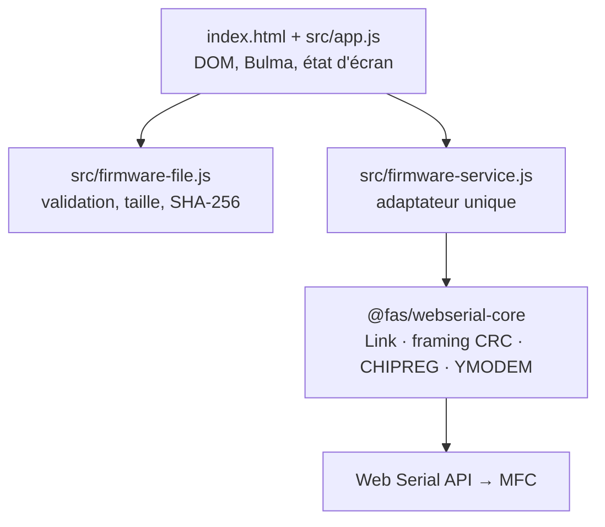

# Architecture — fluid-control-pwa

## 1. Objectif et contraintes

PWA **single page**, hébergée telle quelle sur **GitHub Pages**, permettant de tester et de
mettre à jour des régulateurs de débit (MFC) connectés en série via la **Web Serial API**.

| Contrainte | Conséquence d'architecture |
|---|---|
| GitHub Pages = hébergement statique | aucun backend, aucune variable d'environnement, aucun secret |
| Pas d'étape de build | JavaScript natif en **modules ES**, Bulma en CDN, aucun bundler |
| Sous-chemin `/fluid-control-pwa/` | **tous les chemins sont relatifs** (`./…`), jamais absolus (`/…`) |
| Web Serial API | contexte **HTTPS** obligatoire, Chrome/Edge desktop uniquement, `requestPort()` déclenché par un geste utilisateur |
| PWA | `manifest.webmanifest` + service worker avec cache versionné |

> **Non supporté :** Firefox, Safari, iOS/iPadOS n'implémentent pas la Web Serial API.
> L'application se charge quand même et affiche une bannière d'avertissement.

## 2. Structure du dépôt

```text
fluid-control-pwa/
├── index.html                      page unique (shell Bulma)
├── manifest.webmanifest            métadonnées PWA
├── sw.js                           service worker (precache app shell)
├── .nojekyll                       désactive Jekyll sur GitHub Pages
├── assets/
│   ├── css/app.css                 overrides Bulma minimes
│   └── icons/                      icônes PWA (SVG)
├── src/
│   ├── app.js                      composition : DOM ↔ domaine
│   ├── firmware-file.js            domaine : lecture/validation du fichier
│   ├── firmware-service.js         adaptateur @fas/webserial-core (seul point d'intégration)
│   └── vendor/webserial-core/      distribution ESM de la librairie (non commitée)
├── scripts/vendor-core.ps1         installation/mise à jour de la librairie
└── docs/ARCHITECTURE.md            ce document
```

## 3. Découpage en couches



Règles :

1. **`app.js` ne connaît pas la librairie.** Il n'importe que `firmware-service.js`.
2. **`firmware-file.js` ne touche pas au DOM** ni au port série : testable et réutilisable
   (glisser-déposer, File System Access API…).
3. **`firmware-service.js` est le seul endroit qui importe `src/vendor/webserial-core/`.**
   Changer de version, de chemin ou de mode de livraison n'impacte que ce fichier.
4. L'import de la librairie est **dynamique** (`import()`), donc :
   - elle n'est téléchargée que lorsqu'on en a besoin ;
   - son absence ne casse pas la page, l'UI se dégrade en mode « lecture de fichier seule ».

## 4. Intégration de `@fas/webserial-core`

### 4.1 Ce que fournit la librairie

Branche `feat/typescript-core` du dépôt `PE-FAS-IND/webserial_instrument-core`. Le dossier
`dist/` est **commité** dans la branche : il contient des modules ES `es2022` prêts à
l'emploi (imports relatifs entre chunks, pas de spécificateur « bare » à résoudre).

Points d'entrée utiles :

| Fichier | Contenu |
|---|---|
| `dist/index.js` | noyau : `Link`, `WebSerialTransport`, framings, codecs |
| `dist/devices/chipreg.js` | driver MFC : `createChipreg`, `sendChipregFirmware` |
| `dist/devices.js` | barrel « tous drivers » — **seul endroit exposant `runFirmwareUpdateSequence`** |
| `dist/global/chipreg.global.js` | bundle IIFE autonome exposant `window.ChipregMFC` (compat pages legacy) |

C'est pour `runFirmwareUpdateSequence` que l'adaptateur importe `devices.js` plutôt que
`devices/chipreg.js`.

### 4.2 Option retenue : vendoring de `dist/`

Trois options possibles :

| Option | Avantages | Inconvénients |
|---|---|---|
| **A. Vendoring de `dist/` (retenue)** | zéro build, zéro dépendance réseau, déployable tel quel | mise à jour manuelle via script |
| B. Submodule git | historique de version propre | GitHub Pages ne publie pas les submodules sans workflow Actions |
| C. npm + bundler | ergonomie de dev, types TS | introduit une chaîne de build, contraire à l'objectif |

### 4.3 Procédure

```powershell
# depuis la racine du dépôt
pwsh ./scripts/vendor-core.ps1
```

Le script clone la branche, copie `dist/*` dans `src/vendor/webserial-core/`, supprime les
`.map` (ils pointent vers des sources absentes du déploiement) et préserve le `README.md`
du dossier. Pour travailler depuis un clone local :

```powershell
pwsh ./scripts/vendor-core.ps1 -Source C:\data\github_repo\webserial_instrument-core
```

Après copie, rechargez la page : la bannière d'avertissement disparaît.

### 4.4 ⚠️ Visibilité du dépôt

`@fas/webserial-core` est **privée** et déclarée `UNLICENSED`. Publier `src/vendor/` sur
GitHub Pages rend son code lisible par tous. `.gitignore` exclut donc le dossier par défaut.

Deux scénarios :

- **Dépôt `fluid-control-pwa` privé** (Pages privé = GitHub Enterprise requis), ou publication
  acceptée : retirez la règle de `.gitignore` et committez `src/vendor/webserial-core/`.
- **Dépôt public** : gardez l'exclusion et injectez la librairie au déploiement via un workflow
  GitHub Actions qui clone la librairie avec un token, exécute `vendor-core.ps1`, puis publie
  l'artefact sur Pages. Le code reste hors du dépôt mais devient public sur le site — la
  seule protection réelle est un Pages privé.

**Décision à prendre avant le premier déploiement.**

### 4.5 Séquence de mise à jour firmware

Déjà câblée dans [src/firmware-service.js](../src/firmware-service.js), à activer en étape 2 :

```js
const mfc = createChipreg({ address: "ff" });   // "ff" = broadcast
await mfc.connect();                            // requestPort() + open() — geste utilisateur requis

// 1. Déverrouillage : GOBW puis challenges FWDW/FWCW (bootloader, patcher, application)
const sequence = await runFirmwareUpdateSequence(mfc, { onStep: console.log });

// 2. Le MFC a redémarré en bootloader : le port doit être rouvert
await mfc.reconnect();

// 3. Transfert YMODEM (blocs 1024 o, CRC16 Modbus — pas le CCITT standard)
await sendChipregFirmware(mfc, bytes, { fileName, onProgress: console.log });
```

Détails qui comptent côté UI :

- `runFirmwareUpdateSequence` renvoie `{ success, steps[], failedStep, error }` au lieu de
  lever : l'opérateur doit voir **où** la séquence s'est arrêtée (`jumpToBootloader`,
  `requestBootloaderUpdate`, `confirmBootloaderChallenge`, `requestPatcherUpdate`,
  `confirmPatcherChallenge`, `requestApplicationUpdate`).
- `onProgress` fournit `{ sentBytes, totalBytes, block, percent }` → `progress` Bulma.
- Le port série est **exclusif** : une seule connexion à la fois, `disconnect()` systématique
  dans un `finally`.
- Après `jumpToBootloader`, prévoir le délai de redémarrage ; `ChipregMFC.reconnectWithRetries`
  (API compat) illustre la stratégie de reprise.

### 4.6 Mise à jour de la librairie

1. Rejouer `pwsh ./scripts/vendor-core.ps1`.
2. Incrémenter `CACHE_VERSION` dans [sw.js](../sw.js).
3. Vérifier que les entrées de `APP_SHELL` existent toujours.

## 5. Service worker

Stratégie volontairement simple :

- **Navigation** : réseau d'abord, cache en repli → un déploiement récent est pris en compte
  immédiatement, l'app reste utilisable hors ligne.
- **Autres requêtes** : cache d'abord, puis réseau avec mise en cache (inclut le CSS Bulma du CDN).
- **Invalidation** : `CACHE_VERSION` dans le nom du cache, anciens caches supprimés à l'activation.

La distribution de la librairie n'est pas dans `APP_SHELL` : elle est mise en cache
opportunément au premier usage, ce qui évite un échec d'installation du service worker quand
le dossier `vendor/` est absent.

## 6. Feuille de route

| Étape | Contenu | État |
|---|---|---|
| 1 | Shell PWA + sélection/validation du fichier firmware | fait |
| 2 | Connexion série, séquence de déverrouillage, transfert YMODEM avec barre de progression | à faire |
| 3 | Lecture d'identification (`IDER`) avant flash : contrôle de compatibilité de l'image | à faire |
| 4 | Journal d'opération exportable (traçabilité atelier) | à faire |
| 5 | Lecture temps réel (`SMFR`) et écriture de consigne (`MFSW`) | à faire |

## 7. Développement local

La Web Serial API et `crypto.subtle` exigent un contexte sécurisé : `http://localhost` est
considéré comme sécurisé, `file://` ne l'est pas.

```powershell
npx serve .
# ou
python -m http.server 8000
```
